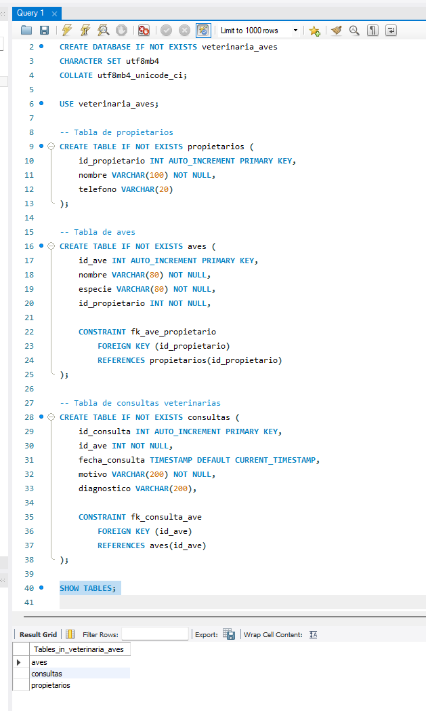
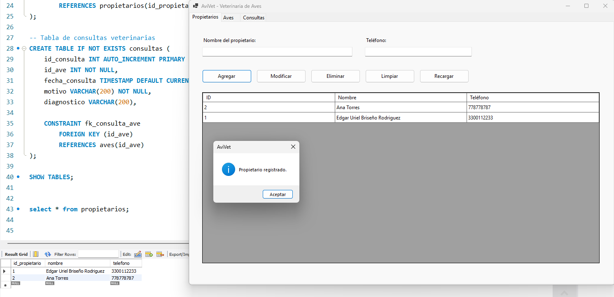
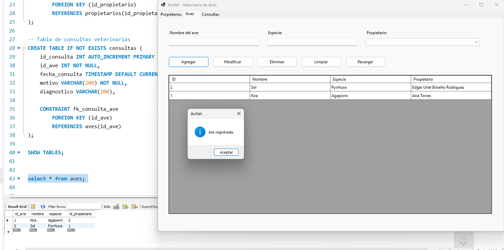
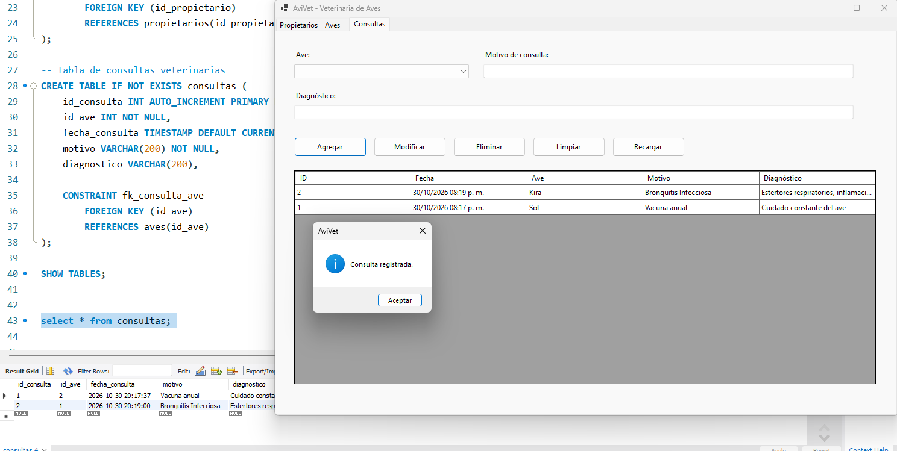
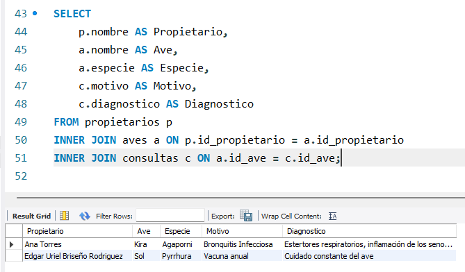

# Actividad 2: Interfaz Gráfica con Conexión a MySQL

**Materia:** Ciberinfraestructura  
**Profesor:** Ma. Inés Calderón Zetter  
**Alumno:** Edgar Uriel Briseño Rodriguez

## Descripción del proyecto

Para la actividad se desarrolla **AviVet**, el cual se trata de una aplicación de escritorio desarrollada en **C# con Windows Forms** y conectada a una base de datos **MySQL**. Simula un registro veterinario de aves, permitiendo administrar propietarios, aves y consultas mediante operaciones de alta, consulta, modificación y eliminación (CRUD). 

## Estructura de la base de datos

La base de datos `veterinaria_aves` contiene tres tablas:

- **`propietarios`:** almacena el nombre y teléfono de los dueños de las aves.
- **`aves`:** registra el nombre y la especie de cada ave, asociándola con un propietario.
- **`consultas`:** guarda la fecha, el motivo y el diagnóstico de las consultas realizadas a cada ave.

Las relaciones son **propietarios (1:N) aves** y **aves (1:N) consultas**.

### DDL de MySQL

```sql
CREATE DATABASE IF NOT EXISTS veterinaria_aves
CHARACTER SET utf8mb4
COLLATE utf8mb4_unicode_ci;

USE veterinaria_aves;

CREATE TABLE IF NOT EXISTS propietarios (
    id_propietario INT AUTO_INCREMENT PRIMARY KEY,
    nombre VARCHAR(100) NOT NULL,
    telefono VARCHAR(20)
) ENGINE=InnoDB;

CREATE TABLE IF NOT EXISTS aves (
    id_ave INT AUTO_INCREMENT PRIMARY KEY,
    nombre VARCHAR(80) NOT NULL,
    especie VARCHAR(80) NOT NULL,
    id_propietario INT NOT NULL,
    CONSTRAINT fk_ave_propietario
        FOREIGN KEY (id_propietario) REFERENCES propietarios(id_propietario)
) ENGINE=InnoDB;

CREATE TABLE IF NOT EXISTS consultas (
    id_consulta INT AUTO_INCREMENT PRIMARY KEY,
    id_ave INT NOT NULL,
    fecha_consulta TIMESTAMP NOT NULL DEFAULT CURRENT_TIMESTAMP,
    motivo VARCHAR(200) NOT NULL,
    diagnostico VARCHAR(200),
    CONSTRAINT fk_consulta_ave
        FOREIGN KEY (id_ave) REFERENCES aves(id_ave)
) ENGINE=InnoDB;
```

## Capturas de la actividad

### 1. Creación de la base de datos

En MySQL Workbench se comprueba que la base de datos `veterinaria_aves` contiene las tablas `propietarios`, `aves` y `consultas`.



### 2. Registro de propietarios

Desde la pestaña **Propietarios** se registra un dueño y se visualiza su información en la tabla de la aplicación.



### 3. Registro de aves

En la pestaña **Aves** se captura el nombre y la especie de un ave, seleccionando al propietario previamente registrado.



### 4. Registro de consultas veterinarias

En la pestaña **Consultas** se selecciona un ave y se almacena el motivo de la visita y su diagnóstico. La fecha se asigna automáticamente en MySQL.



### 5. Verificación de los datos en MySQL

Se realiza una consulta SQL en MySQL Workbench para comprobar que los registros capturados desde la interfaz se guardaron correctamente y mantienen sus relaciones.




**FECHA:** 30/10/2026

